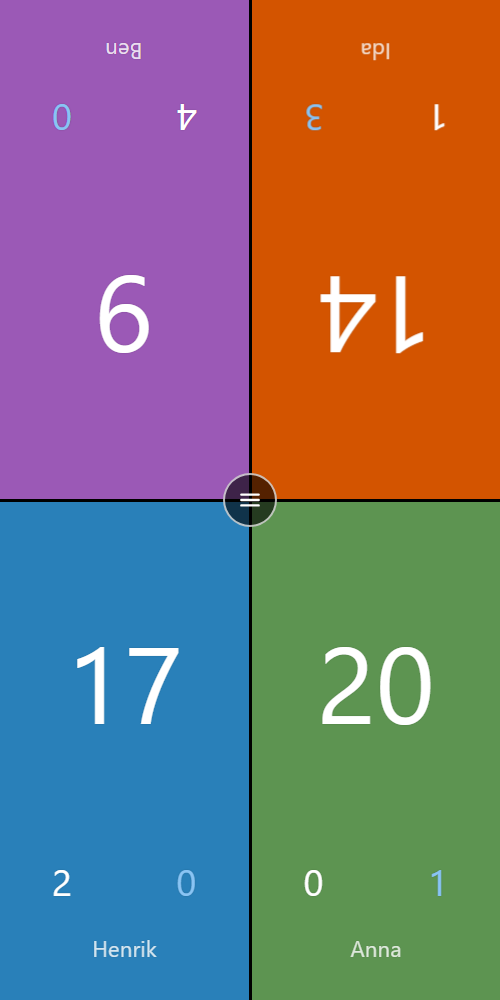
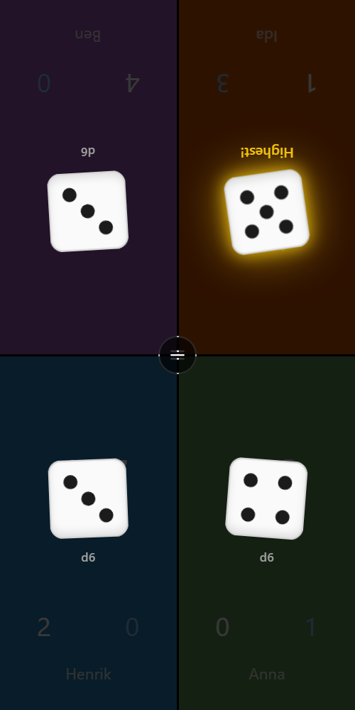
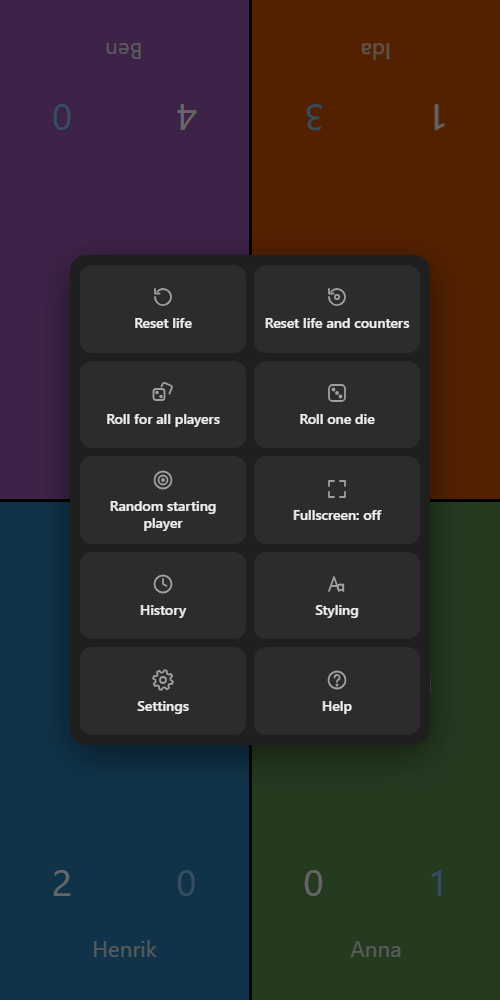
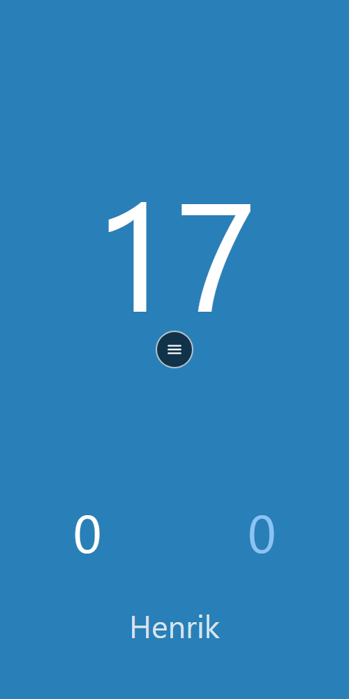
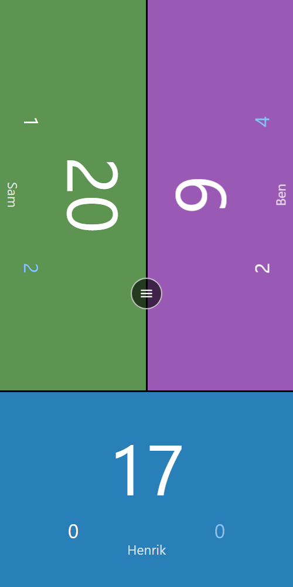
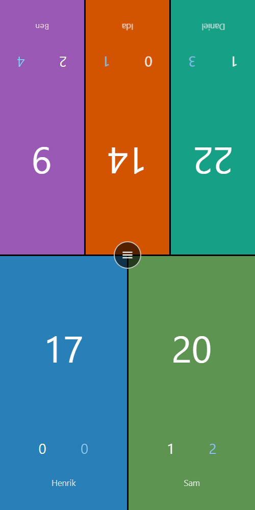
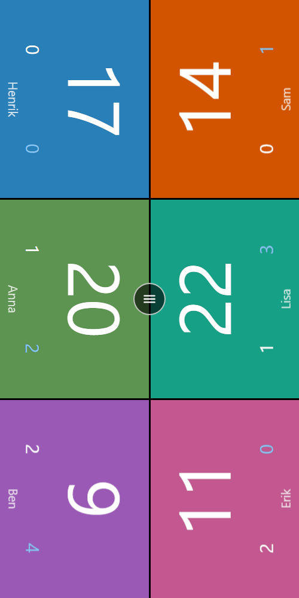
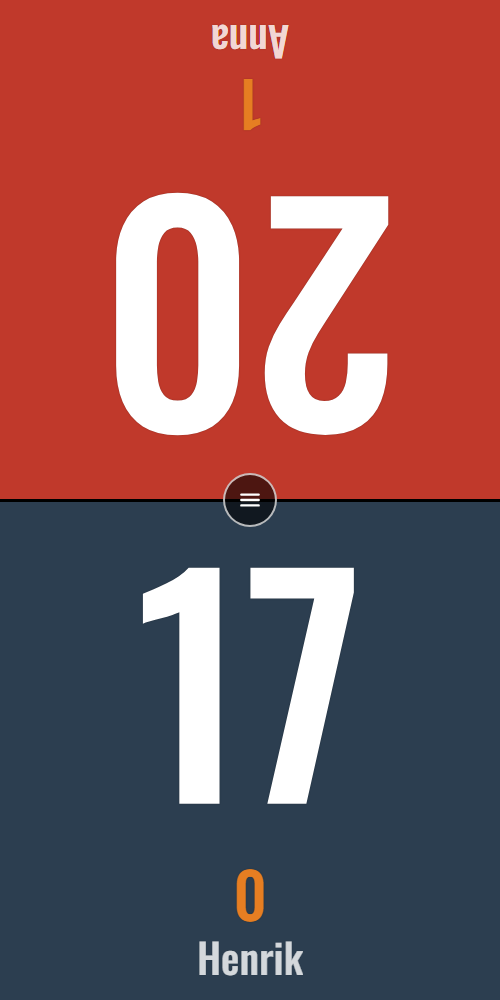

# Neckfors Life Counter

A life counter for card games, for 1–6 players sitting around the table. The phone lies flat in
the middle, and each player's area is turned to face them.

**Open the app: https://neckfors.github.io/life-counter/**

It runs in the browser and can be installed on your phone like an app. Once installed, it works
offline.

  
  
  

## Features

- **1–6 players**, with several layouts for each number of players: facing each other, along the
  sides, everyone facing the same way, and more.
- **Life plus two counters** per player (poison, energy, wins, whatever you need). Counters can be
  named, hidden and given their own starting values.
- **Quick changes:** tap life for ±1, swipe for ±5 (adjustable), or hold to type a value
  (`14` sets it, `+3` / `-7` changes it). The running change, such as −3, shows above the
  number while you tap.
- **Player names with favourites:** hold a name to rename the player, and pick from your saved
  favourites.
- **Dice:** roll a 3D die for every player (the highest wins; ties can re-roll) or one die for the
  table. Any die size.
- **Random starting player:** a highlight runs around the table and stops on the player who starts.
- **History:** a score sheet for each player, plus a detailed log of every change with its time.
- **Reset with undo**, so a wrong tap on Reset is easy to take back.
- **Styling:** text size, typeface and colour, and a background colour for each player.
- **Fullscreen**, **keep screen awake** and **vibrate on tap**.
- **Everything is saved automatically**, after every change.

## Layouts for 1–6 players

Each player count has a few layouts to choose from in Settings, shown there as small previews.
Players can face each other across the table, sit along the long sides, or all face the same way.
With 2 players, both players can also be shown on each side, so everyone sees every total.

  
  
  
  

*From left: 1 player · 3 players, one at the end and two along the sides · 5 players, three
against two · 6 players, three against three, sideways.*

## Styling

The text size, typeface (Normal, Bold, Condensed or Serif) and colour can be changed for life,
names and counters, and the board shows the change as you drag the slider. Each player picks
their own background colour. Either counter can be hidden; life then gets the extra space.

  

*Condensed typeface, life at 120%, orange counter, dark blue and red backgrounds, and the second
counter hidden.*

## Install on your phone

- **Android (Chrome):** open the app, then menu ⋮ → **Install app** (or **Add to Home screen**).
- **iPhone (Safari):** open the app, then **Share** → **Add to Home Screen**.

On iPhone, fullscreen and vibration are not available to web apps. The installed app still hides
the browser bar.

## How to use it

| To… | Do this |
|---|---|
| Change life by 1 | Tap the top half (+1) or bottom half (−1) of the life number |
| Change life by 5 | Swipe up or down on life |
| Change a counter | Swipe up (+1) or down (−1) on the counter |
| Type a value | Hold life or a counter for about a second |
| Rename a player | Hold the name for about a second |
| Everything else | Tap the round button in the middle of the screen |

The **Help** screen in the app explains everything in more detail.

## Development

Plain HTML, CSS and JavaScript (ES modules), with no build step and no dependencies.

- **Run it locally:** `py -m http.server` (or any static web server) in the project folder, then
  open http://localhost:8000.
- **Offline support:** `sw.js` is a service worker that keeps the app's files on the device. When
  publishing a change, increase `VERSION` in `sw.js`, which is how installed apps notice the
  update and show *"Update available — tap to reload"*. New files must also be added to its
  `FILES` list.
- **Hosting:** GitHub Pages, served from the root of the `main` branch.

This is a rebuild of the author's Android app from 2018, as a Progressive Web App.

## Credits

- The **Condensed** typeface is [Oswald](https://github.com/googlefonts/OswaldFont),
  © The Oswald Project Authors, under the SIL Open Font License (see `fonts/OFL.txt`).

## Support

If you like the app, you can support it on [PayPal](https://paypal.me/neckfors). Thank you!
